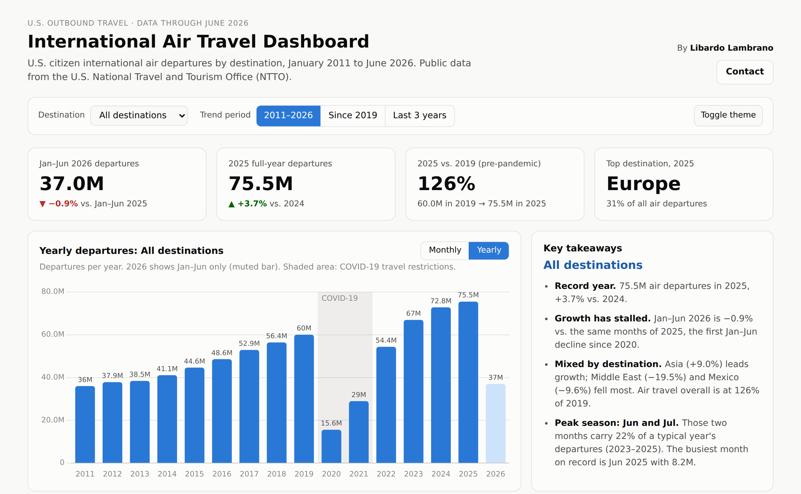

# International Air Travel Dashboard

An interactive dashboard of U.S. citizen international air departures by destination, January 2011 to June 2026, from the U.S. National Travel and Tourism Office (NTTO).

**[Open the live dashboard](https://llambrano.github.io/international-air-travel-dashboard/)**

## What the dashboard shows

| Section | Question it answers |
| --- | --- |
| KPI tiles | How big is the market this year, last year, and versus 2019? |
| Departures over time (Yearly / Monthly toggle) | What is the long-term trend and how deep was the COVID-19 drop? |
| Where Americans fly: 2025 | Which destinations matter most? |
| Growth: Jan–Jun 2026 vs. 2025 | Where is demand rising or falling right now? |
| Recovery: 2025 as % of 2019 | Which destinations have fully recovered? |
| Seasonality heatmap | Which months are busiest, and has the pattern changed? |
| Data table | The annual numbers behind every chart |

Use the **Destination** filter to see any single destination, and click a bar to select it.

### Headline numbers

- **75.5M** international air departures in 2025, a record (+3.7% vs. 2024, 126% of 2019)
- **37.0M** in January–June 2026, **−0.9%** vs. the same months of 2025, the first first-half decline since 2020
- Asia (+9.0%) is growing fastest in 2026; the Middle East (−19.5%) and Mexico (−9.6%) are falling most
- Europe is the top destination with 31% of departures

## Definition

> **International air departures** = the 8 overseas regions (all air) + Mexico (Air) + Canada (Air)

The NTTO "Grand Total" also includes land trips to Mexico and Canada, so it tells a different story: all-mode departures rose 3.4% in January–June 2026 while air departures fell 0.9%. Counts are trips, not unique travelers.

## Data

- `data/us_outbound_by_region_2011_2026.csv`: source data, monthly, tidy format (see `data/DATA_DICTIONARY.md`)
- `data/air_departures_monthly.csv`: air departures, one column per destination
- `images/`: chart images

## Source

U.S. Department of Commerce, International Trade Administration, National Travel and Tourism Office, [US International Air Travel Statistics (I-92 / APIS)](https://www.trade.gov/us-international-air-travel-statistics-i-92-data), "US Outbound to World Regions" workbook dated September 3, 2026. U.S. government data, public domain. Charts use [Chart.js](https://www.chartjs.org) (MIT License, see `vendor/CHARTJS_LICENSE.md`).

## Contact

**Libardo Lambrano** · libardo@syndikomm.com · [LinkedIn](https://www.linkedin.com/in/libardo-lambrano/)
